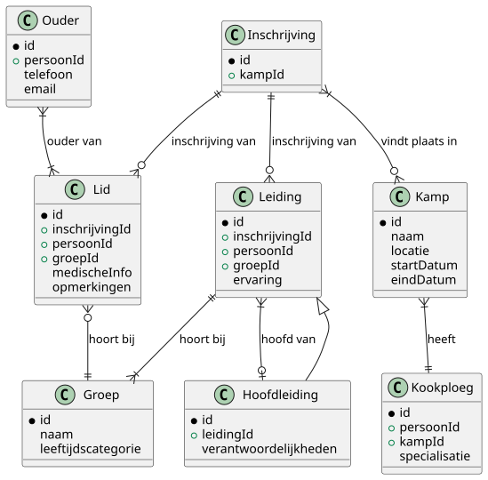
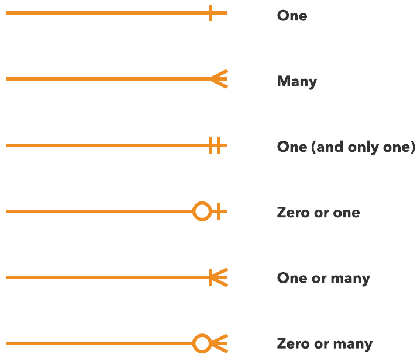

# Dossier KSA Hillegem Webapplicatie

## 📋 Studentgegevens

- **Student:** Kobe Vlieghe
- **Studentennummer:** 202301886
- **E-mailadres:** <kobe.vlieghe@student.hogent.be>

- **Student:** Matteo van Droogenbroeck
- **Studentennummer:** 202406598
- **E-mailadres:** <matteo.van.droogenbroeck@student.hogent.be>
- **GitHub repository:** <https://github.com/HOGENT-frontendweb/frontendweb-2526-mateo-kobe>
- **Online versies:**
  - **Back-end:** <https://api-ksa-hillegem.onrender.com/api/>
  - **Front-end:** <https://ksa-hillegem.onrender.com/home>
- **Demo:** <LINK_NAAR_DEMO_VIDEO> //TODO

## 🔐 Logingegevens

### Hoofdleiding (admin)

- **E-mailadres**: <lotte.staes@gmail.com>
- **Wachtwoord**: 12345678
- **Rol**: hoofdleiding

### Leiding

- **E-mailadres**: <liam.robyns@gmail.com>
- **Wachtwoord**: 12345678
- **Rol**: leiding

### Lid

- **E-mailadres**: <nora.debruyn@gmail.com>
- **Wachtwoord**: 12345678
- **Rol**: lid

## 📖 Projectbeschrijving

Het project is een webapplicatie voor KSA Hillegem, een jeugdbeweging die kampen organiseert voor kinderen en jongeren. De doelgroep bestaat uit leden, leiding, hoofdleiding en ouders van de leden. Het doel van de applicatie is om het beheer van kampen, inschrijvingen en communicatie tussen de verschillende betrokkenen te vergemakkelijken. De applicatie biedt functionaliteiten zoals het bekijken van kampinformatie, inschrijven voor kampen, beheren van kampen, leden en leiding aanmaken. Er is een leiding pagina waar leiding en hoofdleiding getoond wordt. Daarnaast is er een dashboard voor hoofdleiding om een overzicht te krijgen van alle kampen, leden en inschrijvingen.

Je kunt het ERD ook zelf laten genereren via Postman, ga hiervoor naar erd.md in de root. Hier staat uitgelegd hoe je dat doet.

Aangezien het tekens zijn dat aan ons gevraagd werd te verduidelijken zal ik dat hier doen.

| Type | Symbol |
| --- | --- |
| Zero or One | `\|o--` |
| Exactly One | `\|\|--` |
| Zero or Many | `}o--` |
| One or Many | `}\|--` |

De entiteit Kamp vormt het centrale element, waarbij Inschrijvingen deelnemers en leiding aan een specifiek kamp koppelen. Leden en Leiding maken elk deel uit van een Groep, terwijl Hoofdleiding een gespecialiseerde vorm van leiding is met extra verantwoordelijkheden. Ouders zijn verbonden aan één of meerdere leden en dienen als contactpersonen. Daarnaast is er een Kookploeg die minstens aan 1 of meerdere kampen zijn gekoppeld.

## ✅ Ontvankelijkheidscriteria

- [x] Het project van Web Services voldoet aan **alle** ontvankelijkheidscriteria zoals beschreven in de rubrics.
- [x] Het project van Front-end Web Development voldoet aan **alle** ontvankelijkheidscriteria zoals beschreven in de rubrics.

## API calls

Kijk hiervoor naar de documentatie van Swagger op localhost:3000/api/docs of de online versie op [https://api-ksa-hillegem.onrender.com/docs](https://api-ksa-hillegem.onrender.com/docs)

## 🚀 Extra technologieën

### Front-end Web Development

- <https://formik.org/docs/overview>
  - De reden dat we Formik hebben gebruikt is om het beheer van formulieren in onze React-applicatie te vereenvoudigen. Formik biedt een gestructureerde manier om formulierstatus, validatie en afhandeling van inzendingen te beheren, wat de ontwikkelingstijd verkort en de code leesbaarder maakt.
  - Een groot pluspunt is de integratie met Yup voor schema-gebaseerde validatie, wat ons in staat stelt om complexe validatieregels op een eenvoudige en onderhoudbare manier te implementeren.
- Interactieve Google Maps
  - De reden is voor een leuk visueel ligging van KSA Hillegem te tonen aan de gebruikers.
  - Een groot pluspunt is dat gebruikers gemakkelijk de locatie kunnen vinden en navigeren naar KSA Hillegem.

### Web Services

- <https://openapi-generator.tech/>
  - De reden dat we OpenAPI Generator hebben gebruikt is om snel en efficiënt een gestructureerde API-documentatie te genereren. Dit helpt bij het communiceren van de API-specificaties naar zowel ontwikkelaars als andere belanghebbenden. Het bespaart tijd en moeite bij het handmatig schrijven van documentatie en zorgt ervoor dat de documentatie altijd up-to-date is met de codebase.
  - Een zeer groot pluspunt is dat we nog steeds swagger kunnen gebruiken om onze API te testen, wat het ontwikkelingsproces vereenvoudigt.
- Google OAuth2.0
  - We hebben geprobeerd Google OAuth2.0 te implementeren om gebruikers een gemakkelijke en veilige manier te bieden om in te loggen met hun Google-account. Dit vermindert de noodzaak voor gebruikers om aparte inloggegevens te onthouden en verhoogt de gebruiksvriendelijkheid van onze applicatie.
  - Dit was niet gelukt door gebrek aan tijd, maar we zouden dit in de toekomst willen implementeren omdat het een groot pluspunt zou zijn voor de gebruikerservaring.
  
## 🤔 Reflectie

### Kobe Vlieghe

**Wat heb je geleerd?**

In het algemeen werken met React, Tailwind, Formik, Yup, SWR, Axios, Postman, Swagger, authenticatie, autorisatie, rollen, etc.
Eigenlijk zeer veel technologieën die ik nog niet kende.
Daarnaast ook veel geleerd over samenwerken in een team, Git, GitHub, pull requests, code reviews. Ik had vroeger ook dat ik niet goed snapte hoe ik een git merge goed moest doen, maar nu heb ik dat veel beter onder de knie gekregen.

**Wat vond je goed aan dit project?**

Het is een zeer realistisch project met een backend en frontend, wat me een goed beeld gaf van hoe een echte webapplicatie werkt.
Daarnaast vond ik het ook goed dat we in een team konden werken, wat me leerde om samen te werken en te communiceren met anderen. Met hoeveel we moesten doen was in een team werken ook veel efficiënter.

**Wat zou je anders doen?**

Ik zou meer tijd besteden aan het plannen en ontwerpen van de applicatie voordat we begonnen met coderen. Dit zou ons geholpen hebben om een duidelijker beeld te hebben van wat we wilden bereiken en hoe we dat gingen doen. Ik ga vanaf nu ook altijd eerst de backend en dan de front end doen.

**Wat waren de grootste uitdagingen?**

Niet boos worden als ik zat te debuggen voor langer dan 1-2 uur 😓 hahaha. Maar ik vond vooral de authenticatie en autorisatie moeilijk om te snappen.

**Wat zou je behouden aan de cursus?**

De oplossingen van de oefeningen waren zeer nuttig voor een voorbeeld te hebben.

**Wat zou je toevoegen/aanpassen?**

Ik zou meer tijd geven voor de lessen of de cursus verkleinen want het is wel echt ENORM veel nieuw om te leren in zo'n korte tijd. Ik heb voor dit vak echt veel uren moeten steken om alles te begrijpen en te implementeren. En ik heb het gevoel dat ik erdoor andere vakken heb laten liggen.

### Matteo van droogenbroeck

**Wat heb je geleerd?**

Tijdens dit project heb ik leren samenwerken via GitHub en Git. Ik leerde hoe we samen aan één codebase konden werken door gebruik te maken van branches, commits en pull requests.
Ik heb ook leren werken met react, tailwind, formik, yup, swr, axios, postman, swagger, authenticatie, autorisatie, rollen,... .

**Wat vond je goed aan dit project?**

Ik vond het positief dat we een examenopdracht kregen en vond dit ook leuker en leerzamer als gewoon studeren voor een examen.
**Wat zou je anders doen?**
Meer overleggen voor het coderen zodat we een duidelijker plan hebben.

**Wat waren de grootste uitdagingen?**
Ik vond persoonlijke HF9 de back-end testen het moeilijkste om te snappen.

**Wat zou je behouden aan de cursus?**
De oplossingen als voorbeeld zijn zeer handig om het te kunnen implementeren in je eigen project.

**Wat zou je toevoegen/aanpassen?**
Meer mogen aan werken tijdens de les, het was soms veel werk buiten de lessen.

### Reflectie groepswerk

**Hoe verliep het groepswerk?**

- **Kobe Vlieghe:**

  - [ ] Ik heb minder bijgedragen dan mijn groepsgenoot
  - [x] Ik heb evenveel bijgedragen als mijn groepsgenoot
  - [ ] Ik heb meer bijgedragen dan mijn groepsgenoot

- **Matteo van Droogenbroeck:**
  - [ ] Ik heb minder bijgedragen dan mijn groepsgenoot
  - [x] Ik heb evenveel bijgedragen als mijn groepsgenoot
  - [ ] Ik heb meer bijgedragen dan mijn groepsgenoot

**Welke functionaliteiten heeft elk groepslid toegevoegd voor Web Services?**

- **Kobe Vlieghe:**

  - Samen erd gemaakt.
  - Healthcontroller gemaakt.
  - Kampen controller, service, dto's, modellen, migraties, seeders gemaakt.
  - Leden migraties, seeders gemaakt.
  - Leiding migraties, seeders gemaakt.
  - Drizzle schema en seeding gemaakt.
  - Veel op veel tussen kampen en leiding/lid gemaakt.
  - Swagger documentatie aangevuld.
  - Kamp aanmaken call gemaakt.
  - Validatie toegevoegd aan kamp dto's.
  - Validatie pipes gemaakt voor persoonDTO.
  - Backend gedeployed op render.com

- **Matteo van Droogenbroeck:**
  - Samen erd gemaakt.
  - Leiding controller en service gemaakt.
  - Persoon controller en service gemaakt.
  - Auth controller en service gemaakt.
  - JWT authenticatie en autorisatie geïmplementeerd.
  - Rollen systeem geïmplementeerd (lid, leiding, hoofdleiding, ouder).
  - Gebruikersregistratie en login functionaliteit toegevoegd.
  - Swagger documentatie gemaakt.
  - Testen voor de controllers gemaakt.
  - OpenAPI generator geimplementeerd om types te genereren.

**Welke functionaliteiten heeft elk groepslid toegevoegd voor Front-end Web Development?**

- **Kobe Vlieghe:**

  - Home pagina aangemaakt.
  - Kampen pagina met lijst van kampen.
  - Kamp detail pagina.
  - Kampform component voor aanmaken van kampen.
  - Login pagina gemaakt.
  - Alle cypress tests geschreven voor de forms en inschrijven met authenticatie.
  - Gebruik van formik en yup voor formulieren en validatie.
  - SWR voor data fetching.
  - Axios voor API calls geimplementeerd.
  - Frontend gedeployed op render.com
  - Aan de hand van de rollen van de gebruikers bepaalde functionaliteiten getoond of verborgen.

- **Matteo van Droogenbroeck:**
  - Navbar en Footer gemaakt.
  - React router ingesteld.
  - About me pagina gemaakt.
  - Leiding pagina gemaakt.
  - cypress login en register
  - Register gemaakt.
  - Hooks.
  - Theme context gemaakt voor dark/light mode.
  - Authenticatie token beheer met localStorage.
  - Error handling voor API calls.
  - Gebruikerssessie beheer.
  - /me endpoint gebruikt om ingelogde gebruiker gegevens op te halen.
